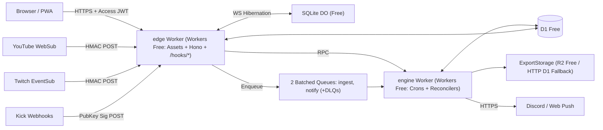

# Clipse Radar — Phase 0 Architecture & Delivery Plan

## 1. Verified Platform & Provider Facts (§3 — 100% Free Tier, $0/mo)
- **Cloudflare Free Limits (Nov 2026, $0/mo total):** Workers Free: 100k req/d, 10ms CPU/req, 50 subrequests, 5 crons. D1 Free: 5M rows read/d, 100k rows written/d, 5 GB; **since 2026-09-01 queries fail immediately on limit** until midnight UTC. Queues Free: 10k ops/d. SQLite-backed DO (`new_sqlite_classes`): 100k req/d, 13k GB-s/d, WS Hibernation. Access Free: <=50 users. R2 Free: 10 GB (fallback: HTTP/D1 export if R2 card-on-file is disabled). Static Assets requests are free. Both `edge` and `engine` run on Workers Free with graceful degradation (banner + queued retries).
- **Static Assets & Auth:** `edge` uses Workers Static Assets with `run_worker_first: ["/api/*", "/hooks/*"]`. `edge` manually verifies `Cf-Access-Jwt-Assertion` (`aud`, `iss`, `exp`) using `jose` (`createRemoteJWKSet` cached outside `fetch`, `jwtVerify`).
- **YouTube Data API v3:** 10,000 units/day (reset midnight PT). `videos.list` = 1 unit (<=50 IDs). `videos.batchGetStats` = 1 unit (preferred for stat snapshots). Never use `search.list` (100/day bucket).
- **Twitch Helix & EventSub:** EventSub webhooks (`stream.online`/`stream.offline`, app token) use HMAC + 10-min timestamp window + 24h `message_id` dedupe. `Get Clips` (`first <= 100`) returns `vod_offset` / `video_id`, which are `null`/empty until VOD is processed (and clear on VOD expiry). `Get Streams` batches <=100 IDs.
- **Kick Public API:** Webhooks (`livestream.status.updated`) verified via `Kick-Event-Signature` using `GET /public/v1/public-key` (dynamic, not hardcoded). Official `/public/v1/` has **no clips or VODs endpoint**.

## 2. Compliance Obligations (§4.2)
- **YouTube:** Refresh or delete raw metadata (titles, descriptions, creator names, stats) within **30 calendar days**. Submit **Derived Metrics Amendment** form before shipping `Rising` scores; label custom scores as independently generated. Official APIs only, link to source, follow branding rules.
- **Twitch:** Developer Services Agreement **24-hour cache limit** on non-broadcaster-authorized public data; refresh or purge <=24h and honor deletions/expirations.
- **Kick:** OAuth 2.1 (`id.kick.com` / `api.kick.com`, PKCE `S256`), minimal scopes, webhooks/official REST only, **zero scraping** or undocumented `/api/v2/` calls.

## 3. Architecture Diagram

## 4. Module Map
- `packages/core`: pure domain types, `zod` schemas, `Rising` / `LiveMoments` / `Shorts` scoring, `Provider` / `AuthProvider` / `InsightsProvider` / `ExportStorage` / `Notifier` ports (0 I/O, 100% unit-tested).
- `apps/edge`: Hono HTTP router, `jose` Access JWT verifier, `/hooks/{youtube,twitch,kick}`, D1 repositories, Service Binding RPC client, SQLite-backed Workspace DO (WS Hibernation).
- `apps/engine`: cron triggers (<=5), 2 batched Queue consumers (`ingest`, `notify` + DLQs), adaptive reconcilers, token-bucket quota governor, `ExportStorage` exporter, Discord/VAPID notifiers.
- `apps/web`: React 19 + TS strict + Vite + Tailwind v4 + TanStack Router/Query + `stageshow` tokens/components + minimal PWA service worker.

## 5. ERD (Global vs Workspace-Scoped)
- **Global (shared):** `platform_accounts` (`id`, `platform`, `external_id`, `handle`, `last_synced_at`), `items` (`id`, `account_id`, `external_id`, `kind`, `title`, `published_at`, `first_seen_at`, `raw_refreshed_at`), `item_stats` (`item_id`, `captured_at`, `views`, `likes`, `comments`), `live_samples` (`item_id`, `sampled_at`, `viewers`).
- **Workspace-scoped (`workspace_id` + compound indexes, keyset pagination):** `workspaces`, `memberships` (`role`: Owner/Admin/Member/Viewer), `follows` (`account_id`, `starred`, `is_own`, `rules_json`), `claims` (`item_id`, `user_id`, `start_sec`, `end_sec`, `status`), `clips` (`claim_id`, `url`, `platform`, `manual_stats_json`), `alerts` (`item_id`, `type`, `confidence`, `evidence_json`), `alert_votes` (`alert_id`, `user_id`, `useful`), `notifications` (`user_id`, `tier`, `read_at`), `audit_logs`.

## 6. API Contracts & Event Flows
- **Edge API (`/api/v1/*`):** `GET /health`, `GET /me`, `POST/GET/PATCH /sources`, `GET /feed` (keyset cursor), `GET /live`, `GET /rising`, `POST/DELETE /claims` (atomic overlap check), `POST/GET /clips`, `POST /alerts/:id/vote`, `GET /reports/daily`, `GET /admin/scorecard`, `POST /export`.
- **Event Flow:** Webhook/Reconciler -> `ingest` queue (batched normalize, upsert global item + `first_seen_at`, inline `Rising`/`LiveMoments` eval + stats enrich, emit WS ID) -> `notify` queue (batched rules, quiet hours, user budget, Discord/Web Push/in-app). Each queue has a `*-dlq` with admin visibility.

## 7. Provider Quota & Free-Tier Budget (per 500 tracked creators, $0/mo)
| Resource | Free-Tier Limit | Est. Daily Usage | Control |
|---|---|---|---|
| Workers / SQLite DO | 100k req/d, 10ms CPU, 13k GB-s/d | ~18k req/d (<6ms CPU/req) | Small batches + WS Hibernation |
| Queues Free | 10,000 ops/day | ~3,500 ops/d (2 batched queues) | Batch <=25 msgs; inline eval |
| D1 Free | 100k writes/d, 5M reads/d | ~35k writes/d, ~400k reads/d | 7d raw prune; zero OFFSET |
| YouTube / Twitch / Kick | 10k YT units/d; app limits | ~1,800 YT units; ~4k Helix/Kick | Token bucket + starred-only live |

## 8. Threat Model Summary & Performance Budgets
- **Threats (`docs/SECURITY.md` in Phase 1):** Tenant IDOR (`workspaceId` from verified JWT membership only), Webhook forgery/replay (HMAC/Ed25519 + 10m window + 24h dedupe), SSRF (strict `(platform, id)` parser, fixed hosts), XSS/Discord mention injection (CSP no `unsafe-inline`, `allowed_mentions: { parse: [] }`), Secret leakage (`.dev.vars` + AES-GCM at rest), Cost DoS (WAF + per-workspace quotas), Prompt injection (AI off by default, $0 AI cost).
- **Budgets (CI-enforced):** Initial JS `<= 170 KB` gz, CSS `<= 25 KB` gz, LCP `<= 2.0 s`, INP `<= 150 ms`, CLS `<= 0.05`, API read `p95 <= 200 ms`, Lighthouse mobile Perf `>= 95` / A11y `>= 95` / BP `100`.

## 9. Test Strategy & Environments
- **Tests:** `packages/core` 100% unit + property tests (`Rising`, `LiveMoments`, `Shorts`); `edge`/`engine` Miniflare Workers runtime integration + recorded provider fixtures + IDOR matrix + webhook forgery/replay; Playwright (Chromium/Firefox/WebKit x 1440/820/390/320 + throttled) + axe + Lighthouse CI.
- **Environments:** `local` (`wrangler dev` + `.dev.vars`), `staging` (`*.workers.dev` — note public HTTPS webhook requirement outside Access), `prod` (custom domain + Access + gradual rollout). Total cloud cost: **$0/mo**.

## 10. Task Map (Phases 0–7)
| ID | Task | Agent | Depends On | Dirs/Files | Exit Criteria | Risk | Status |
|---|---|---|---|---|---|---|---|
| P0.1 | Verify §3/§4.2, ADRs, AGENTS, PLAN | architect | — | `AGENTS.md`, `docs/PLAN.md`, `docs/adr/*` | Reviewer pass + G0 approval | Low | done |
| P1.1 | Monorepo, CI, wrangler, staging | platform | P0.1 | `package.json`, `.github/*`, `wrangler.*` | Green CI, staging live ($0 Free) | Med | done |
| P1.2 | `SECURITY.md`, Access JWT, headers, D1 | backend | P1.1 | `docs/SECURITY.md`, `packages/core`, `apps/edge` | Header scan clean, JWT/IDOR tests | High | done |
| P1.3 | `stageshow` tokens, shell, health UI | frontend | P1.1 | `apps/web` | 4-viewport QA, budgets pass | Med | done |
| P2.1 | Provider ports, YT/Twitch/Kick adapters | ingestion | P1.2 | `packages/core`, `apps/engine` | Contract tests on recorded fixtures | High | done |
| P2.2 | Webhooks, 2 queues, reconcilers, governor | ingestion | P2.1 | `apps/edge/hooks`, `apps/engine` | Forgery/replay/out-of-order tests | High | done |
| P3.1 | Sources, Feed, Live, Rising, Claims API | backend | P2.2 | `apps/edge`, `packages/core` | Atomic claim overlap + IDOR tests | Med | done |
| P3.2 | Core UI (Sources, Feed, Live, Claims) | frontend | P1.3, P3.1 | `apps/web` | Playwright 3-engine + mobile E2E | Med | done |
| P4.1 | Live Moments, VOD-ready, rules, push/Discord | signals | P3.1 | `packages/core`, `apps/engine` | Replay harness + escalation tests | Med | done |
| P4.2 | Notification center, PWA push, votes UI | frontend | P4.1 | `apps/web` | Push/offline/vote E2E pass | Med | done |
| P5.1 | Clip Log, Our channels, ROI, Scorecard, Report | backend | P4.1 | `packages/core`, `apps/edge`, `apps/engine` | Truth audit + export tests | Med | done |
| P5.2 | Clip Log, ROI, Scorecard, Reports, Settings UI | frontend | P5.1 | `apps/web` | Full flow E2E + zero mock data | Low | done |
| P6.1 | Security/perf/truth audit, DR drill, 24h soak | security, qa, perf | P5.2 | `docs/RUNBOOK.md`, tests | Zero defects, soak report, RPO/RTO | High | in_progress |
| P7.1 | Prod deploy, smoke test, Discord alerts | platform, lead | P6.1 | `wrangler.*`, `docs/RUNBOOK.md` | Gradual rollout + prod smoke pass | Med | in_progress |

## 11. Real Risks & Open Questions (<=5)
1. **`git` missing from PATH** on Windows dev machine; blocks commits/hooks until Git for Windows is installed/added to PATH.
2. **`pnpm.ps1` blocked** by PowerShell execution policy; all scripts and agent commands must use `cmd /c pnpm`.
3. **Staging webhooks vs `*.workers.dev`:** `/hooks/*` must bypass Cloudflare Access and remain reachable over public HTTPS by YouTube/Twitch/Kick.
4. **Free-tier ceilings & R2 fallback:** Workers Free (10ms CPU), Queues Free (10k ops/d), and D1 Free (fail-on-limit) require small batches and graceful degradation; `ExportStorage` falls back to HTTP/D1 export if R2 card-on-file is disabled.
5. **Twitch 24h cache & Kick clips absence:** Twitch non-authorized public data cannot be cached >24h; Kick `/public/v1/` has no clips/VODs endpoint (viewer-count spikes only).

## 12. Feature Acceptance Matrix (§2 v1)
| # | Feature | Implementation Approach | Objective Acceptance Test |
|---|---|---|---|
| 1 | Access & workspaces | Cloudflare Access + `jose` JWKS verify; D1 `workspaces`/`memberships`/`audit_logs` | Valid JWT maps role; missing/invalid JWT returns 401/403; IDOR matrix fails cross-tenant |
| 2 | Sources | Strict `(platform, id)` parser, bulk CSV import, global `platform_accounts` + `follows` | Valid/invalid URLs/CSV resolve or reject; duplicate follow is idempotent; no SSRF |
| 3 | Ingestion | `Provider` port (`YT`/`Twitch`/`Kick`), `/hooks/*` + 2 batched queues + reconcilers | Recorded fixture contract tests + webhook HMAC/replay/out-of-order tests pass |
| 4 | Feed | Unified D1 query with keyset cursor, filters, dedupe, `first_seen_at` latency stamp | Keyset pagination returns zero dupes/gaps; `first_seen_at` and source/age render |
| 5 | Live Now | `live_samples` + SQLite Workspace DO WS Hibernation event IDs + polling fallback | Stream online/offline updates board via WS; viewer count shows source + age |
| 6 | Live Moments + VOD | Rolling baseline viewer spike + Twitch clip velocity (`vod_offset` / `approx.`) | Replay harness fires Low/Med/High confidence; VOD-ready alert fires on VOD match |
| 7 | Rising | Pure `packages/core` median/MAD velocity + engagement + hysteresis (`Rising`/`Breakout`/`Viral`) | Property tests + replay verify thresholds, reason string, and zero flapping |
| 8 | Claims (item/range) | Atomic D1 transaction on `(item_id, start_sec, end_sec)` + 1x unclaimed reminder | Concurrent claim test allows 1 winner; overlapping range rejected; 1 reminder max |
| 9 | Team loop | `own` channels prefill Clip Log, exact URL match, batched YT stats, manual non-YT, ROI | Own upload prefills log; exact match links; manual stats labelled; ROI shows floor |
| 10 | Accuracy scorecard | Recorded alert evidence + 24h top-20% / vote / clip-proxy backtest + quota/D1 telemetry | Scorecard computes precision with sample floor ("not enough data yet" below floor) |
| 11 | Notifications | P1/P2/P3 rules, hourly budget, snooze, quiet hours, Discord (`allowed_mentions:[]`), VAPID | Budget/quiet-hours suppressions, 429 backoff, mention-escape, vote persistence pass |
| 12 | Daily Report | Deterministic UTC->workspace-TZ daily rollup per member/team ($0 AI off by default) | Aggregated counts match DB; template renders exact deterministic metrics |
| 13 | Settings / export / delete | Member/integration/rule CRUD, `ExportStorage` JSON/CSV export, atomic workspace delete | Export contains workspace rows only; delete purges all tenant tables + audit logged |
